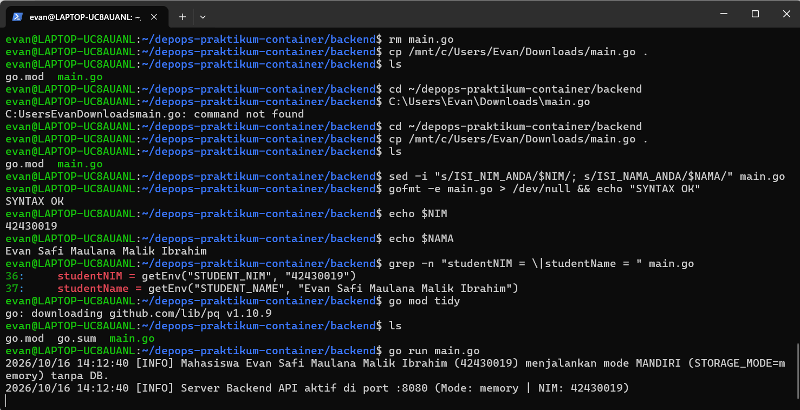
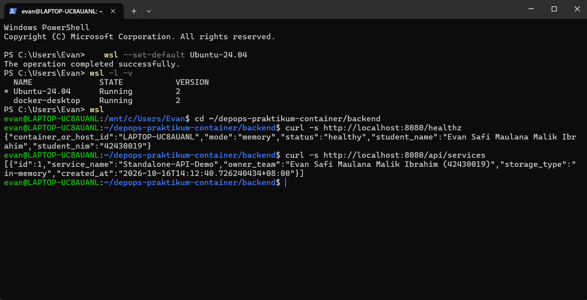
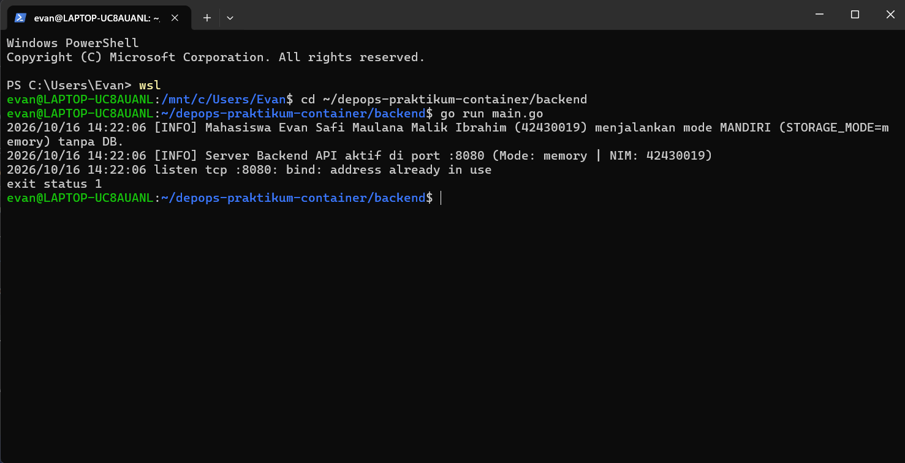
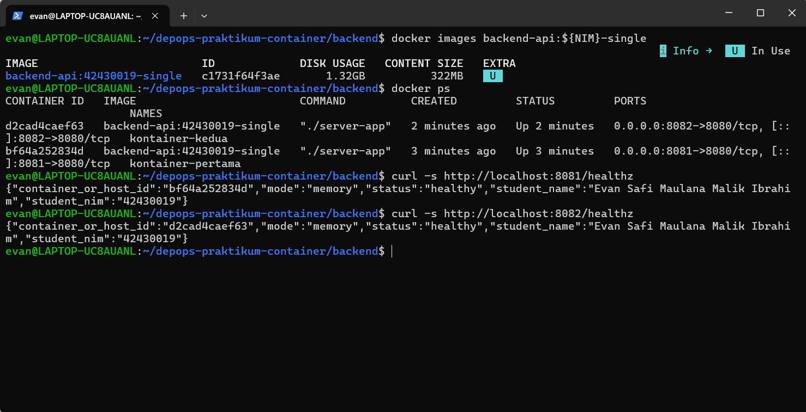
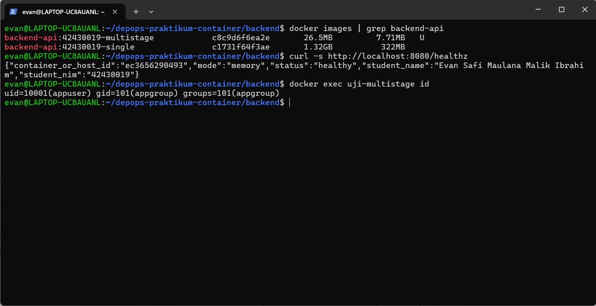
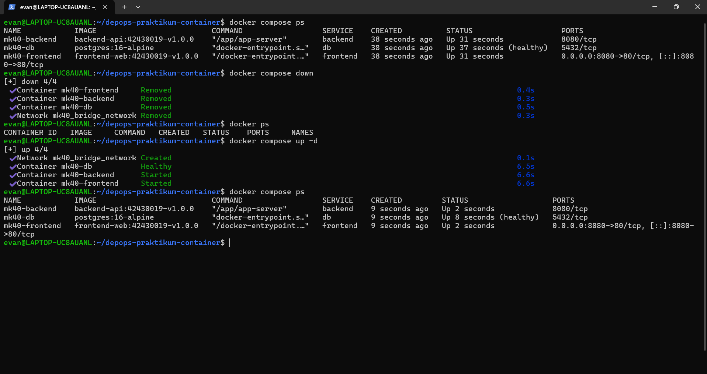
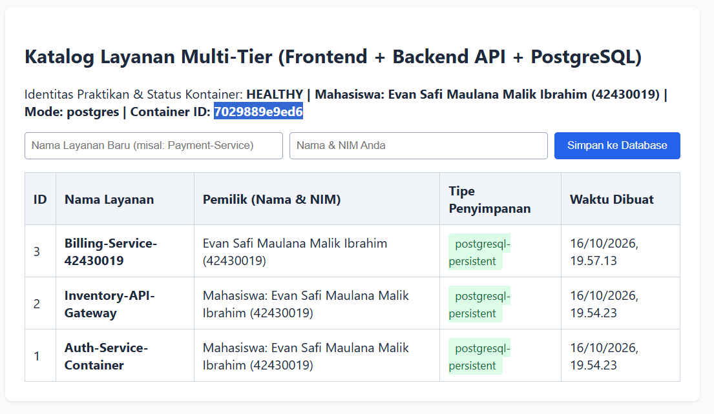

# Laporan Praktikum Modul 1 (Pertemuan 4): Kontainerisasi Docker & Orkestrasi Multi-Tier (Lab 1 & Lab 2)

- **Nama Mahasiswa**: [Evan Safi Maulana Malik Ibrahim]
- **NIM**: [42430019]
- **Kelas / Prodi**: S1 Teknologi Informasi – UNDIKNAS Denpasar
- **Tautan Branch / Pull Request GitHub**: [https://github.com/Xrimm/depops-praktikum-container/tree/lab1-2/42430019-evan / Rosan]
- **Nama Rekan Peer-Reviewer**: [Rosan Kelvino & 42430025]
---

## 1. Tabel Komparasi Eksperimen Individu (Tahap 1 vs. Tahap 2 vs. Tahap 3)

| Parameter Pembanding | Tahap 1: Tanpa Docker (Native di Host OS) | Tahap 2: Docker Single-Stage (`Dockerfile.single`) | Tahap 3: Docker Multi-Stage (`Dockerfile`) |
| :--- | :--- | :--- | :--- |
| **Kebutuhan Instalasi Go di Host** | Wajib instal Go SDK di laptop | Tidak wajib (cukup Docker) | Tidak wajib (cukup Docker) |
| **Ukuran Image (`docker images`)** | Tidak menghasilkan image | 1.32 GB | 26,5 MB (< 100 MB) |
| **Output `container_or_host_id` & NIM** | Hostname: `LAPTOP-UC8AUANL` \| NIM: `42430019` | Container ID: `3b5a816e44c5` \| NIM: `42430019` | Container ID: `7029889e9ed6` \| NIM: `42430019` |
| **User Eksekusi Proses (`id`)** | User laptop saat ini | `uid=0 (root)` | `uid=10001 (appuser)` |
| **Menjalankan 2 Instansi Sekaligus** | Gagal (`bind: address already in use`) | Berhasil (`-p 8081:8080` & `-p 8082:8080`) | Berhasil (`-p`) |
---

## 2. Bukti Screenshot & Penjelasan Analisis Setiap Tahapan

### A. Tahap 1 – Eksekusi Aplikasi Mandiri Tanpa Docker (Baseline)

* **Penjelasan Tahap 1**:
Pada tahap pertama ini, aplikasi dijalankan langsung di sistem operasi laptop tanpa docker. Karena hal tersebut, nilai 'container_or_host_id' pada 'healthz' berisi hostname laptop yang sedang digunakan 'LAPTOP-UC8AUANL' dan bukan id container.

Saat aplikasi kedua dijalankan, muncul error 'bind: address already in use'. Karena port 8080 sudah dipakai oleh aplikasi pertama, hal tersebut menunjukkan adanya konflik port karena satu port hanya bisa dipakai untuk satu proses.

### B. Tahap 2 – Kontainer Tunggal dengan Single-Stage Dockerfile

* **Penjelasan Tahap 2**:
Pada tahap kedua ini, docker digunakan agar dua aplikasi dapat berjalan bersamaan tanpa adanya konflik port karena setiap container memiliki jaringan terisolasinya sendiri-sendiri. Walaupun keduanya tetap memakai port 8080, konflik dapat dihindari karena container pertama dipetakan ke host lewat '-p 8081:8080' tetapi container kedua lewat '-p 8082:8080'. Sehingga port yang terbuka di laptoop berbeda.

Ukuran pada image single-stage juga membengkak menjadi 1.32GB karena base image-nya yaitu 'golang:1.22-bookworm' berisi OS lengkap beserta compiler go dan toolchain, semua itu ikut tersimpan ke dalam image akhir bersama source code-nya. Walaupun yang benar-benar dibutuhkan untuk menjalankan aplikasi hanya file biner hasil kompilasi.

### C. Tahap 3 (Lab 1 RPS) – Optimasi Dockerfile Multi-Stage Build (< 100 MB)

* **Penjelasan Tahap 3**:
Pada tahap ketiga ini, ukuran image turun dari 1.32GB menjadi 26,5MB melalui multi-stage, sehingga penghematan yang terjadi mencapai sekitar 98% dan memenuhi syarat di bawsah 100MB.

Instruksi 'COPY --from=builder' berfungsi untuk menyalin file biner hasil kompilasi-nya saja dari stage 'builder' ke stage 'production'. Sehingga compiler go, source code, dan cache build-nya tetap tertinggal di stage pertama dan tidak masuk ke image akhir.

Instruksi 'USER appuser' membuat aplikasi berjalan sebagai user biasa dengan id 'uid=10001' dan bukan root. Alasan keamanannya yaitu apabila aplikasi berjasil dibobol, penyerang hanya akan mendapatkan hak akses terbatas di dalam container saja, dan bukan hak penuh sebagai root.

### D. Tahap 4 (Lab 2 RPS) – Orkestrasi Multi-Tier & Persistensi Data dengan Docker Compose

* **Penjelasan Tahap 4**:
Pada tahap keempat ini, Named volume 'pgdata' dipasang ke '/var/lib/postgresql/data', yaitu lokasi penyimpanan data PostgreSQL.'Docker compose down' hanya menghapus container dan jaringannya, sedangkan datanya tetap tersimpan karena volume berada di luar container.

Frontend tidak terhubung langsung ke database. Nginx pada 'frontend' meneruskan request '/api/' ke 'http://backend:8080' lewat 'proxy_pass', lalu 'backend' menghubungi database dengan 'DB_HOST=db'. Ketiganya berada di jaringan bridge 'mk40_bridge_network' dan saling menemukan lewat nama layanan, yang diterjemahkan oleh DNS bawaan Docker. Container 'db' tidak memiliki bagian 'ports:', sehingga port 5432 hanya bisa dijangkau dari dalam jaringan dan tidak terbuka ke publik.

### E. Tahap 5 – Skenario Troubleshooting & Analisis Error

* **Penjelasan Tahap 5**:
Pada tahap kelima ini, ‘localhost’ di dalam container backend tidak merujuk ke container db karena setiap container memiliki network namespace sendiri, sehingga ‘localhost’ hanya menunjuk ke container backend itu sendiri yang tidak menjalankan PostgreSQL.

Perintah ‘docker compose down -v’ berbahaya karena ikut menghapus named volume ‘pgdata’, sehingga seluruh data PostgreSQL hilang permanen.

## 3. Bukti Audit Silang (Peer-Review) di GitHub
- **Tautan Pull Request (PR)**: `https://github.com/.../pull/...`
- **Ringkasan Catatan Peer-Reviewer**: [Tuliskan hasil verifikasi dari rekan yang memeriksa PR Anda]
